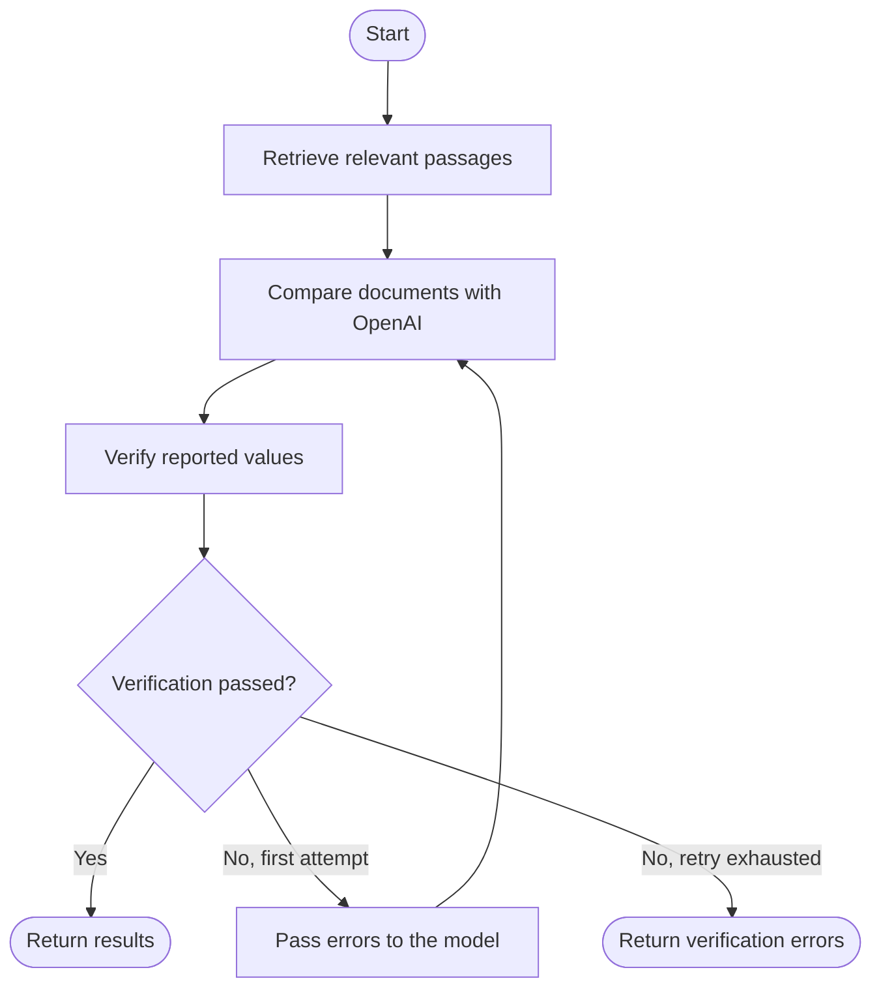

# DocuCompare AI

DocuCompare AI is a document comparison tool that uses AI to help identify differences between documents. The idea behind the project is to make it easier to compare contracts and other text-heavy documents without manually reading every section.

The application extracts text from PDF and TXT files, indexes the content for semantic search, and uses an LLM to generate a summary of the differences. I also implemented a LangGraph workflow that checks the comparison results and retries the process if verification fails.

## What it can do

- Extract text from PDF and TXT documents.
- Split documents into smaller chunks and generate embeddings.
- Store document embeddings in Qdrant for semantic search.
- Retrieve relevant passages from two documents.
- Use OpenAI to generate a summary and identify differences between clauses.
- Validate reported values against the retrieved document text.
- Retry a comparison when verification fails.
- Expose the functionality through a REST API with interactive Swagger documentation.

## How it works

The application has two main workflows: document indexing and document comparison.

When a document is indexed, its text is extracted, divided into chunks, converted into embeddings, and stored in Qdrant. When a comparison is requested, the application retrieves relevant passages from both documents and sends them to the OpenAI model.

The comparison process is managed by LangGraph, which allows each step to be handled separately and makes it possible to retry a comparison when the verification step finds problems.

### Architecture


### LangGraph workflow



The retry mechanism is limited to one retry after the initial attempt, so the workflow cannot continue indefinitely.

## Tech stack

- **Python** — main programming language
- **FastAPI** — REST API
- **PyMuPDF** — PDF text extraction
- **LlamaIndex** — text chunking and document processing
- **FastEmbed** — embedding generation
- **Qdrant** — vector database and semantic search
- **OpenAI API** — document comparison and structured output
- **LangGraph** — workflow orchestration
- **Pydantic** — request and response schemas
- **Pytest** — automated testing
- **Docker** — running Qdrant locally

## Getting started

### Requirements

- Python
- Docker
- An OpenAI API key

### 1. Clone the repository

```bash
git clone https://github.com/lukagobechia/docucompare-ai.git
cd docucompare-ai
```

### 2. Create a virtual environment

```bash
python3 -m venv .venv
source .venv/bin/activate
```

### 3. Install dependencies

```bash
pip install -r requirements.txt
```

### 4. Configure environment variables

Create a `.env` file in the project root and add your OpenAI API key:

```env
OPENAI_API_KEY=your_openai_api_key_here
```

Replace the placeholder with your own key. Keep `.env` out of version control.

### 5. Start Qdrant

```bash
docker run -d \
  --name docucompare-qdrant \
  -p 6333:6333 \
  qdrant/qdrant
```

If you already have Qdrant running, you can use your existing instance instead.

### 6. Run the API

```bash
uvicorn docucompare.main:app --reload --app-dir src
```

Once the application starts, open:

- Swagger UI: http://localhost:8000/docs
- ReDoc: http://localhost:8000/redoc
- Qdrant dashboard: http://localhost:6333/dashboard

## API endpoints

| Endpoint | Description |
|---|---|
| `POST /documents/extract` | Extract text from a document |
| `POST /documents/index` | Index a document for semantic search |
| `POST /documents/search` | Search document content |
| `POST /compare` | Compare two indexed documents |

The `/compare` endpoint accepts two document IDs and a search query. It returns a summary, a list of differences, retrieved passages from both documents, and the verification status.

You can try the endpoints directly through Swagger UI without needing a separate API client.

## Running tests

To run the test suite:

```bash
PYTHONPATH=src pytest -q
```

The current test suite contains 12 passing tests, including tests for the LangGraph routing logic and its retry behavior.

## What I learned

This project gave me practical experience with retrieval-augmented generation, vector databases, structured LLM responses, and stateful AI workflows. It also helped me understand how to combine traditional backend development with LLM-based features and how to add basic verification instead of blindly trusting model-generated results.

## Current limitations

The verification step checks whether reported values appear in the retrieved document text. This helps catch some unsupported values, but it does not guarantee that every comparison is correct. Scanned PDFs may also require OCR support.

The project is intended as an AI engineering portfolio project, not as a replacement for professional legal review.

## Future improvements

- Improve semantic verification of clauses and values.
- Add OCR support for scanned documents.
- Expand automated evaluation of retrieval and comparison quality.
- Add authentication and production-ready deployment configuration.
- Improve logging and monitoring.